# GPS Control — Plataforma de Monitoreo y Administración de Flotas

Plataforma web full stack para el monitoreo y la administración de flotas vehiculares mediante integración con **Wialon**. El sistema permite visualizar unidades en un mapa, consultar telemetría e historiales de recorrido, gestionar conductores y pasajeros, administrar usuarios y auditar operaciones.

**Stack principal:** FastAPI, Python, React, Vite, PostgreSQL, SQLAlchemy, Alembic, Wialon Remote API y Leaflet.

---

## 1. Demo y enlaces

| Recurso | Enlace |
|---|---|
| Aplicación web | https://gps-control-pi.vercel.app |
| API REST (base) | https://gpscontrol-production.up.railway.app/api/v1 |
| Documentación Swagger | https://gpscontrol-production.up.railway.app/api/docs |
| Repositorio | https://github.com/BreynerAnaconaB/gps_control |

> **Acceso de demostración:** no se publican contraseñas ni tokens en este repositorio. Si se habilita una cuenta de demostración, sus credenciales deben entregarse por un canal separado y seguro. El usuario administrador inicial se configura mediante las variables de entorno utilizadas por `scripts/seed_admin.py`.

---

## 2. Capturas de pantalla

### 2.1 Monitoreo de flota y mapa en tiempo real

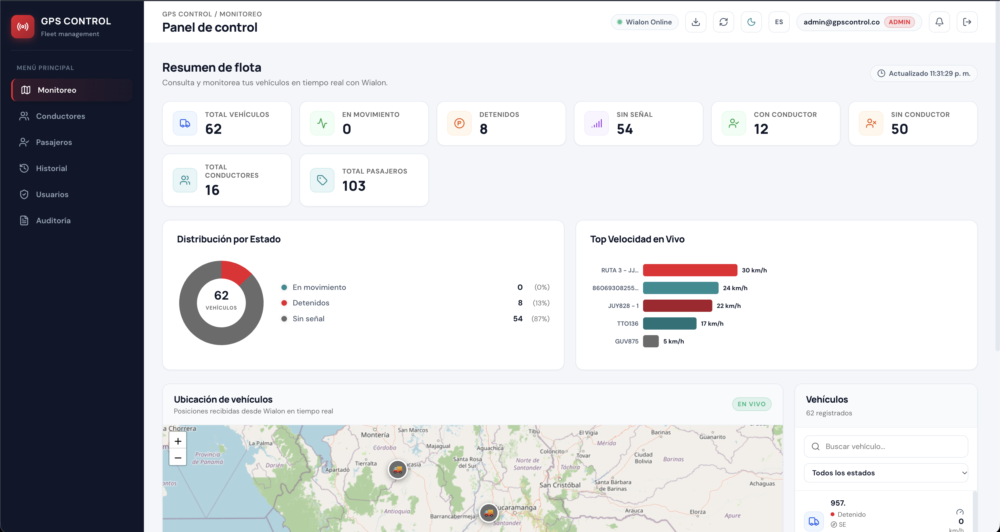

### 2.2 Gestión de conductores y vinculación telemática

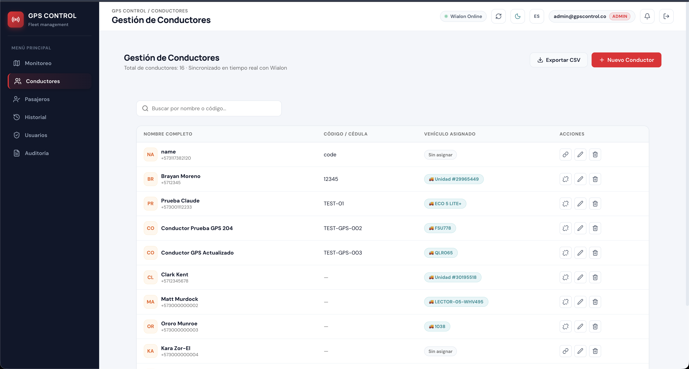

### 2.3 Gestión de pasajeros y etiquetas sincronizadas con Wialon

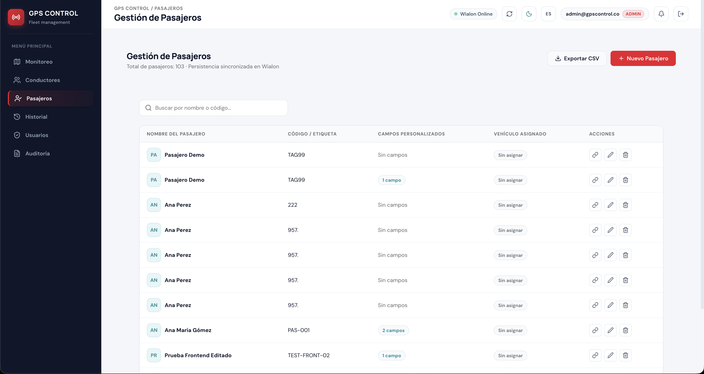

### 2.4 Historial de recorridos y telemetría

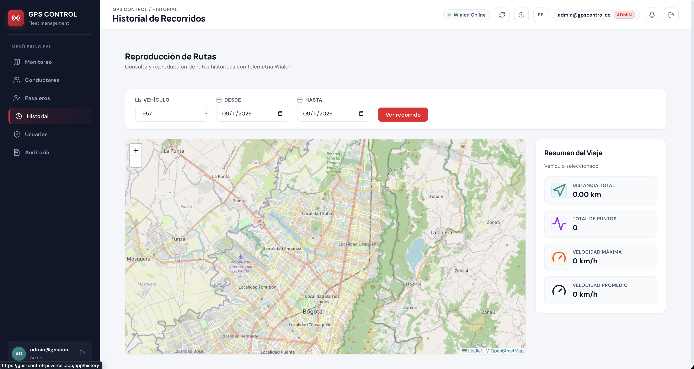

### 2.5 Administración de usuarios y control de acceso RBAC

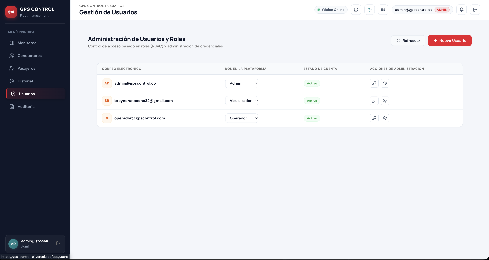

### 2.6 Registro de auditoría

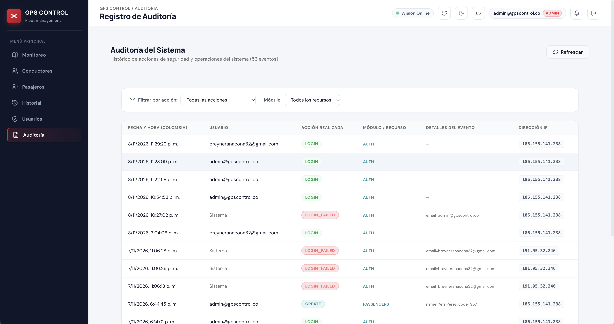

### 2.7 Experiencia móvil y navegación responsive

| Landing móvil | Menú responsive | Dashboard móvil |
|---|---|---|
| 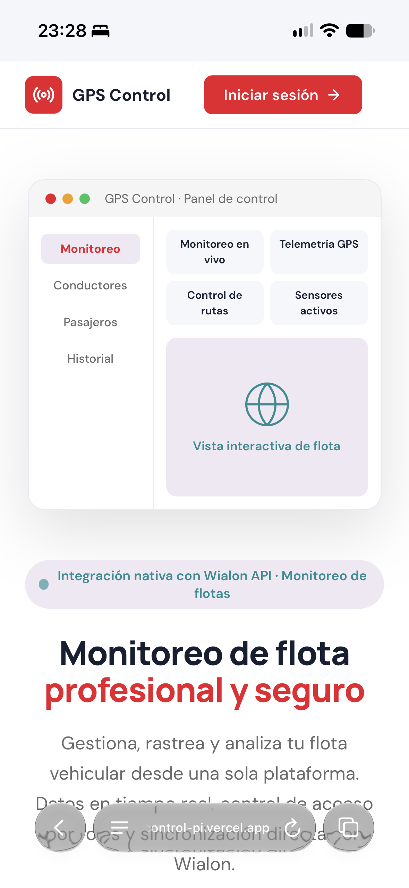 | 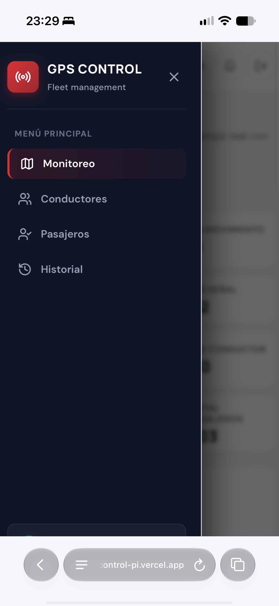 | 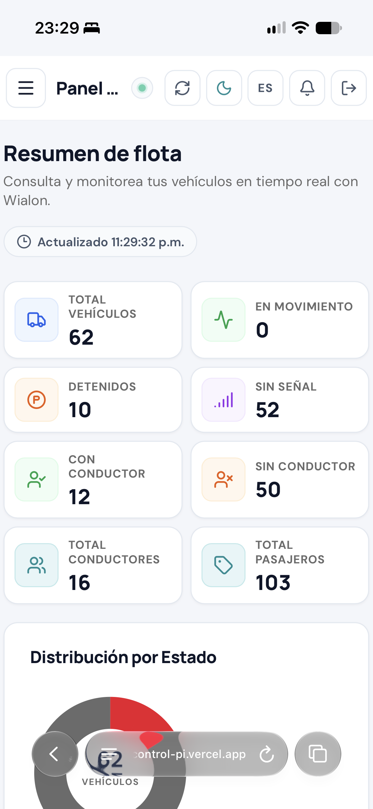 |

---

## 3. Tecnologías utilizadas

| Capa | Tecnología | Uso en el proyecto |
|---|---|---|
| Backend | Python 3.12, FastAPI | API REST, validación de solicitudes y lógica de aplicación. |
| Frontend | React 19, JavaScript, Vite 8 | Interfaz web modular y construcción de recursos del cliente. |
| Base de datos | PostgreSQL | Persistencia relacional de usuarios, roles, permisos, sesiones de renovación y auditoría. |
| ORM y migraciones | SQLAlchemy 2, Alembic | Acceso a datos y versionamiento del esquema. |
| Integración GPS | Wialon Remote API | Consulta y administración de unidades, conductores, pasajeros, campos y mensajes telemáticos. |
| Mapas | Leaflet, React-Leaflet, Leaflet.markercluster | Representación geográfica y agrupamiento de marcadores. |
| Seguridad | Argon2id, PyJWT, SlowAPI | Hash de contraseñas, tokens y limitación de intentos de autenticación. |
| Pruebas | Pytest, pytest-asyncio, Node Test Runner | Pruebas automatizadas de backend y frontend. |
| Infraestructura | Docker, Docker Compose, Nginx | Ejecución local contenerizada y servicio del frontend. |
| Despliegue | Vercel, Railway | Publicación del frontend y backend. |

---

## 4. Funcionalidades principales

### 4.1 Monitoreo de vehículos

- Visualización de unidades en un mapa interactivo con agrupamiento de marcadores.
- Consulta de coordenadas, velocidad, rumbo y telemetría disponible.
- Clasificación de vehículos en movimiento, detenidos o sin señal.
- Búsqueda por texto, filtros por estado y paginación en servidor.
- Sincronización entre la lista de unidades y los marcadores del mapa.
- Actualización periódica de información mediante polling cada 30 segundos, con pausa cuando la pestaña queda en segundo plano.

### 4.2 Gestión de conductores y pasajeros

- Operaciones de creación, consulta, actualización y eliminación de conductores mediante Wialon.
- Gestión de pasajeros mediante los recursos de etiquetas de Wialon.
- Edición de campos personalizados de pasajeros.
- Vinculación y desvinculación de conductores y unidades, aplicando la regla de exclusividad definida por el sistema.
- Actualización optimista de la interfaz con reversión visual cuando una operación falla.

### 4.3 Campos personalizados de unidades

- Consulta, creación, edición y eliminación de campos personalizados de vehículos mediante Wialon.

### 4.4 Dashboard y métricas

- Indicadores de unidades totales, en movimiento, detenidas y sin señal.
- Conteos de conductores y pasajeros.
- Gráficas de distribución de estados y actividad de la flota.
- Acceso al detalle de las unidades asociadas a las métricas.

### 4.5 Historial de recorridos

- Consulta de trayectorias por vehículo y rango de fechas.
- Cálculo de distancia recorrida mediante la fórmula de Haversine.
- Reproducción del recorrido con control temporal y marcador dinámico.
- Visualización de velocidad durante la reproducción.
- Límite defensivo de mensajes consultados por intervalo para controlar el volumen de datos.

### 4.6 Seguridad y administración

- Administración de usuarios y asignación de roles.
- Control de acceso basado en roles y permisos (RBAC).
- Solicitud de cambio de contraseña en el primer inicio de sesión cuando corresponde.
- Registro de eventos de auditoría.
- Exportación CSV de información de vehículos, conductores y pasajeros.
- Sanitización de valores exportados para reducir el riesgo de CSV Injection.
- Temas claro y oscuro mediante variables CSS.

---

## 5. Arquitectura del sistema

El proyecto separa la interfaz, la API, la lógica de negocio, la infraestructura y los servicios externos. En el backend, los endpoints delegan el trabajo en servicios y dependencias; el acceso a PostgreSQL y Wialon se mantiene en sus respectivas capas.

### 5.1 Diagrama de arquitectura

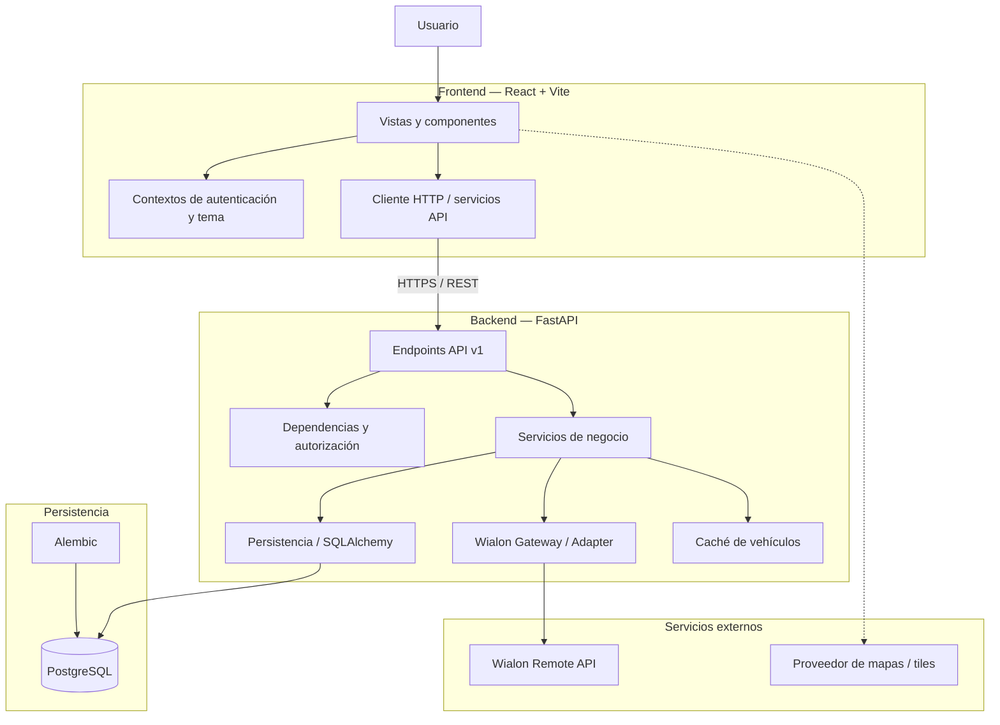

### 5.2 Responsabilidades por capa

1. **Presentación:** `backend/app/api/v1/endpoints/` recibe solicitudes HTTP, valida los datos y delega las operaciones. La interfaz se encuentra en `frontend/src/`.
2. **Servicios:** `backend/app/services/` concentra reglas de negocio y coordina operaciones sin trasladar esa responsabilidad a los endpoints.
3. **Infraestructura:** `backend/app/infrastructure/` contiene componentes de integración y persistencia, incluido el acceso a Wialon y SQLAlchemy.
4. **Persistencia:** PostgreSQL almacena los datos propios de la plataforma. Alembic versiona los cambios del esquema.
5. **Servicios externos:** Wialon proporciona información y operaciones telemáticas. El mapa utiliza Leaflet y los recursos cartográficos configurados.

### 5.3 Flujo general de una solicitud

1. El usuario realiza una acción desde la interfaz.
2. El cliente HTTP envía la solicitud a la API.
3. FastAPI valida la entrada y ejecuta las dependencias de autenticación y autorización aplicables.
4. El endpoint delega la operación al servicio correspondiente.
5. El servicio consulta o actualiza PostgreSQL y/o se comunica con Wialon.
6. La API devuelve una respuesta validada y la interfaz actualiza la vista.

---

## 6. Modelo de datos

PostgreSQL almacena las entidades propias de la aplicación. La información telemática de vehículos y otros recursos administrados en Wialon se obtiene del servicio externo y no debe confundirse con las tablas relacionales de la plataforma.

### 6.1 Diagrama entidad-relación

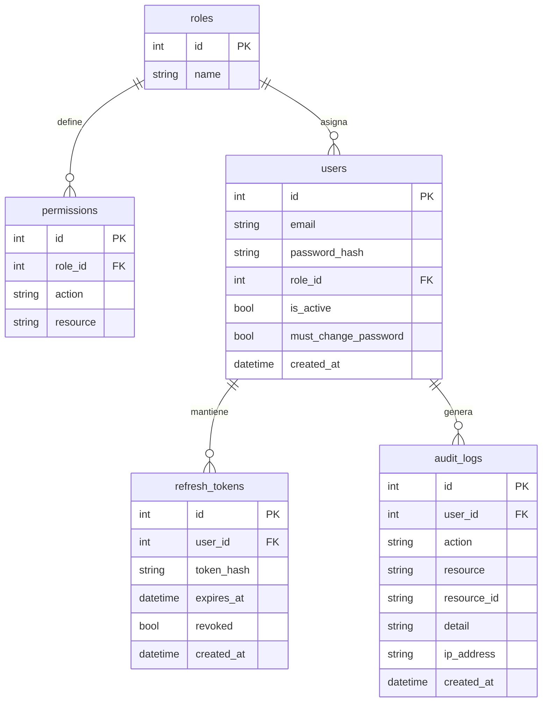

> El diagrama representa las entidades principales documentadas. Para una representación exhaustiva, debe mantenerse sincronizado con los modelos y migraciones reales del backend.

### 6.2 Migraciones

El esquema se versiona con Alembic.

- Configuración: `backend/alembic.ini`
- Entorno de migraciones: `backend/migrations/env.py`
- Migraciones: `backend/migrations/versions/`

Para aplicar las migraciones:

```bash
cd backend
alembic upgrade head
```

---

## 7. Principios SOLID y patrones de diseño

Los siguientes son los principios y patrones identificados en la estructura del proyecto. Las referencias deben interpretarse junto con la implementación actual de cada archivo.

### 7.1 Principios SOLID

| Principio | Referencia | Aplicación descrita |
|---|---|---|
| **SRP — Responsabilidad única** | `backend/app/services/driver_service.py`, `auth_service.py` | Separación de responsabilidades por dominio de negocio. |
| **OCP — Abierto/cerrado** | `backend/app/infrastructure/wialon/gateway.py` | Encapsulamiento de operaciones de Wialon para centralizar su evolución y reducir cambios en los consumidores. |
| **LSP — Sustitución de Liskov** | Cliente Wialon y dobles de prueba en `backend/tests/` | Uso de implementaciones simuladas en pruebas para aislar dependencias externas, siempre que respeten el contrato utilizado por el consumidor. |
| **ISP — Segregación de interfaces** | `backend/app/api/v1/dependencies.py` | Dependencias específicas para base de datos, gateway, caché y autorización. |
| **DIP — Inversión de dependencias** | `backend/app/api/v1/endpoints/` y `dependencies.py` | Resolución de dependencias desde FastAPI en lugar de construir todas las dependencias dentro de cada endpoint. |

### 7.2 Patrones de diseño

| Patrón | Ubicación | Propósito |
|---|---|---|
| **Adapter / Gateway** | `backend/app/infrastructure/wialon/gateway.py` | Encapsular el protocolo de Wialon detrás de operaciones utilizadas por la aplicación. |
| **Caché con TTL y sincronización** | `backend/app/services/vehicle_cache.py` | Reutilizar resultados durante un intervalo y coordinar accesos concurrentes a la caché. |
| **Gestor de sesión** | `backend/app/infrastructure/wialon/session.py` | Centralizar la sesión de comunicación con Wialon y su renovación. |
| **DTO / Mapper** | `backend/app/api/v1/schemas/` | Validar y estructurar los datos de entrada y salida de la API. |
| **Factory de dependencias** | `backend/app/api/v1/dependencies.py` | Construir dependencias de autorización parametrizadas. |
| **Singleton Promise** | `frontend/src/services/authService.js` | Evitar solicitudes simultáneas de renovación de sesión mediante una promesa compartida. |

### 7.3 Decisiones arquitectónicas (ADR)

| ID | Decisión | Motivo |
|---|---|---|
| ADR-001 | Separar endpoints y servicios de negocio | Mantener las responsabilidades HTTP separadas de las reglas del dominio. |
| ADR-002 | Integrar Wialon mediante un Gateway | Evitar que los detalles del protocolo externo se propaguen por toda la aplicación. |
| ADR-003 | Usar PostgreSQL con SQLAlchemy y Alembic | Mantener persistencia relacional y evolución versionada del esquema. |
| ADR-004 | Usar polling periódico para actualizar el mapa | Implementar actualización periódica sin incorporar inicialmente una infraestructura de WebSockets. |

---

## 8. Seguridad y OWASP

La siguiente tabla resume controles contemplados o implementados en el proyecto. La presencia de una medida en el código no equivale por sí sola a una certificación de seguridad; cada control debe probarse en el entorno desplegado.

| Categoría OWASP Top 10 (2021) | Control o tratamiento |
|---|---|
| **A01 — Broken Access Control** | RBAC y validación de permisos en el backend mediante dependencias de autorización. |
| **A02 — Cryptographic Failures** | Hash de contraseñas con Argon2id. Uso de tokens de acceso y cookies de renovación con atributos de seguridad según la configuración del entorno. |
| **A03 — Injection** | Uso del ORM SQLAlchemy y consultas parametrizadas. Sanitización de valores exportados a CSV. |
| **A04 — Insecure Design** | Roles diferenciados y separación de responsabilidades entre endpoints, servicios e infraestructura. |
| **A05 — Security Misconfiguration** | Configuración de CORS, cabeceras HTTP de seguridad y validación de parámetros sensibles de configuración. |
| **A06 — Vulnerable and Outdated Components** | Dependencias declaradas en archivos de configuración. Se recomienda ejecutar auditorías de dependencias de forma periódica. |
| **A07 — Identification and Authentication Failures** | Hash seguro de contraseñas, limitación de intentos de inicio de sesión y ciclo de renovación de tokens. |
| **A08 — Software and Data Integrity Failures** | Validación de datos de entrada mediante esquemas y controles de tipos. |
| **A09 — Security Logging and Monitoring Failures** | Registro de operaciones relevantes en auditoría y logging de aplicación. |
| **A10 — Server-Side Request Forgery (SSRF)** | El destino de las solicitudes a Wialon se configura en el backend; no debe permitirse que el usuario final controle libremente esa URL. |

### 8.1 Modelado de amenazas resumido

| Activo / superficie | Amenaza | Impacto posible | Mitigación |
|---|---|---|---|
| Cuentas de usuario | Robo o adivinación de credenciales | Acceso no autorizado | Hash de contraseñas, limitación de intentos y cambio de contraseña cuando corresponda. |
| API REST | Acceso a operaciones fuera del rol asignado | Exposición o modificación de datos | Verificación de permisos en el servidor, no solo en la interfaz. |
| Tokens y cookies | Robo, reutilización o renovación indebida | Suplantación de sesión | Vida limitada, renovación controlada y atributos de cookie adecuados al despliegue. |
| Base de datos | Inyección o acceso indebido | Alteración o exposición de información | ORM, credenciales por entorno y permisos mínimos de conexión. |
| Integración Wialon | Indisponibilidad, expiración de sesión o respuesta inesperada | Pérdida temporal de telemetría o fallos operativos | Manejo de errores, validación de respuestas y gestión centralizada de sesión. |
| Exportaciones CSV | Interpretación de celdas como fórmulas | Ejecución de fórmulas al abrir el archivo | Sanitización de valores exportados. |

**Límites:** este modelado es de alto nivel. No sustituye una evaluación de penetración, una revisión de configuración de infraestructura ni pruebas específicas de abuso de permisos.

---

## 9. Decisiones de diseño y accesibilidad

### 9.1 Paleta visual

La interfaz utiliza una paleta basada en el rojo corporativo, tonos neutros y un color secundario teal.

| Color | Código | Uso previsto |
|---|---|---|
| Rojo corporativo | `#EB162C` | Acciones principales, identidad visual y estados críticos. |
| Rojo oscuro | `#A81A2B` | Variantes hover y acentos. |
| Gris neutro | `#6B6B6B` | Texto secundario, metadatos y elementos de apoyo. |
| Teal | `#1E8C93` | Indicadores secundarios y estados positivos. |
| Lavanda claro | `#EEE8F2` | Superficies suaves y elementos del tema claro. |

### 9.2 Temas y accesibilidad

- La interfaz ofrece tema claro y oscuro mediante variables CSS.
- Los controles deben conservar estados visibles de foco para navegación por teclado.
- Los colores no deben ser el único medio para comunicar el estado de un vehículo.
- Los textos, iconos y controles deben mantener contraste suficiente en ambos temas.
- Las capturas de este README deben mostrar la interfaz sin información sensible.

> **Pendiente de validación:** no se declara conformidad WCAG AA global hasta completar mediciones de contraste, revisión de navegación por teclado y pruebas con herramientas de accesibilidad sobre las vistas principales.

---

## 10. Transformación y normalización de datos de Wialon

El backend adapta los datos recibidos desde Wialon a estructuras utilizadas por la aplicación.

| Dato de origen | Transformación | Regla documentada |
|---|---|---|
| Timestamp UNIX | Fecha ISO-8601 y presentación en hora local | Zona horaria de visualización: `America/Bogota` (UTC-5). |
| Velocidad | Normalización a km/h | Redondeo a un decimal. |
| Posición | Validación de latitud y longitud | Las coordenadas deben ser válidas para representar una ubicación. |
| Estado del vehículo | `moving`, `stopped` o `no_signal` | Se aplican antigüedad del reporte y umbral de velocidad. |
| Rumbo | Dirección cardinal | Conversión por sectores de 45 grados. |
| Pasajeros | Interpretación de etiquetas de Wialon | Se utiliza la máscara `0x200000` documentada en la integración. |

### 10.1 Reglas de estado del vehículo

| Estado | Condición |
|---|---|
| `no_signal` | Latitud o longitud nulas, o reporte con antigüedad superior a 10 minutos (`MAX_POSITION_AGE_MINUTES = 10`). |
| `moving` | Posición válida y velocidad superior a 3 km/h (`SPEED_THRESHOLD_KMH = 3.0`). |
| `stopped` | Posición válida, reporte reciente y velocidad menor o igual a 3 km/h. |

### 10.2 Ejemplo conceptual

```json
{
  "position": {
    "latitude": 4.6097,
    "longitude": -74.0817
  },
  "speed": 42.5,
  "course": 90,
  "status": "moving"
}
```

> El ejemplo es ilustrativo del formato normalizado; no representa datos reales de una unidad ni una respuesta literal garantizada de Wialon.

---

## 11. Instalación y ejecución local

### 11.1 Requisitos previos

- Python 3.12 o compatible con las dependencias del proyecto.
- Node.js 22 o compatible con Vite y las dependencias instaladas.
- PostgreSQL para el entorno relacional local.
- Credenciales y configuración de acceso a Wialon para probar las funciones que dependen de ese servicio.
- Git.

### 11.2 Clonar el repositorio

```bash
git clone https://github.com/BreynerAnaconaB/gps_control.git
cd gps_control
```

### 11.3 Configurar el backend

```bash
cd backend
python -m venv ../.venv
source ../.venv/bin/activate
pip install -r requirements.txt
cp .env.example .env
```

Edita `backend/.env` y configura las variables requeridas por `backend/.env.example`. Como mínimo, revisa:

- URL y credenciales de PostgreSQL.
- Clave de firma de tokens.
- Configuración de Wialon.
- Orígenes permitidos para CORS.
- Parámetros de entorno y depuración.

No subas el archivo `.env` al repositorio ni compartas sus secretos.

Aplica las migraciones y, si corresponde, crea el usuario administrador inicial:

```bash
alembic upgrade head
python -m scripts.seed_admin
```

Inicia el servidor:

```bash
uvicorn app.main:app --reload --port 8000
```

La API local estará disponible en `http://localhost:8000`. La ruta de documentación depende de la configuración de depuración del backend.

### 11.4 Configurar el frontend

Abre otra terminal desde la raíz del repositorio:

```bash
cd frontend
npm install
```

Crea `frontend/.env` a partir de `frontend/.env.example` si ese archivo existe en el repositorio y configura la URL de la API:

```env
VITE_API_URL=http://localhost:8000/api/v1
```

Inicia Vite:

```bash
npm run dev
```

La aplicación estará disponible en `http://localhost:5173`.

### 11.5 Ejecución con Docker Compose

Desde la raíz del repositorio:

```bash
docker compose up --build
```

La configuración de Docker Compose utiliza las variables de entorno y los servicios declarados en el archivo `docker-compose.yml`. Consulta ese archivo y los archivos de configuración de `docker/` para verificar los puertos y requisitos del entorno local.

---

## 12. Pruebas y calidad

### 12.1 Backend

Ejecutar desde `backend/` con el entorno virtual activado:

```bash
pytest -v
```

Último resultado documentado durante el desarrollo: **58 pruebas aprobadas**.

Áreas cubiertas:

- Autenticación y ciclo de vida de tokens.
- Autorización basada en roles.
- Reglas de estado de vehículos.
- Caché y concurrencia.
- Exportaciones CSV y sanitización.
- Seguridad de endpoints.
- Estado de dependencias y sesión Wialon.
- Datos de detalle de vehículos.
- Cliente de integración Wialon.

### 12.2 Frontend

Ejecutar desde `frontend/`:

```bash
npm test
npm run lint
npm run build
```

Último resultado documentado durante el desarrollo:

- **10 pruebas aprobadas** en Node Test Runner.
- Compilación de producción completada correctamente.
- ESLint reportó advertencias que deben revisarse; no se deben presentar como errores corregidos hasta que desaparezcan o se documenten explícitamente.

> Los resultados son los de una ejecución durante el desarrollo y pueden cambiar con nuevas modificaciones. Ejecuta nuevamente los comandos antes de entregar una versión final.

---

## 13. Supuestos y decisiones ante ambigüedades

1. **Fuente de telemetría:** Wialon se considera la fuente externa de información telemática. PostgreSQL almacena los datos propios de la plataforma.
2. **Actualización del mapa:** se utiliza polling periódico de 30 segundos. No se considera una transmisión instantánea por WebSockets.
3. **Clasificación de estado:** se utilizan los umbrales de antigüedad y velocidad descritos en la sección de transformación de datos.
4. **Zona horaria:** la visualización de fechas se orienta a `America/Bogota`; los timestamps deben conservar una referencia temporal consistente.
5. **Roles y permisos:** las restricciones importantes se validan en el backend. Ocultar botones en el frontend no constituye un control de seguridad suficiente.
6. **Disponibilidad de Wialon:** las funciones que dependen de la API externa requieren que Wialon esté disponible y que la sesión sea válida.
7. **Entorno local:** para probar el flujo completo se necesita configurar PostgreSQL y las credenciales de Wialon; sin ellas, algunas funciones solo podrán probarse mediante pruebas automatizadas o dobles de prueba.

---

## 14. Declaración de uso de inteligencia artificial

Durante el desarrollo se utilizó **Google Antigravity (Gemini)** como herramienta de asistencia.

Ámbitos de apoyo declarados:

- Generación inicial y apoyo en boilerplate de migraciones Alembic.
- Consulta y análisis de documentación y comportamiento de la API de Wialon.
- Apoyo en la redacción y estructuración de pruebas automatizadas.
- Revisión y optimización de configuración de construcción del frontend con Vite.

El uso de estas herramientas no sustituye la revisión del código. La implementación, integración, ejecución de pruebas y validación final deben ser verificadas por el autor. Esta declaración debe actualizarse si se utilizaron otras herramientas de IA o si su participación fue distinta en alguna parte del proyecto.

---

## 15. Limitaciones conocidas y mejoras futuras

1. **Actualización mediante polling:** la telemetría se consulta periódicamente cada 30 segundos. Se podría evaluar WebSockets o un mecanismo de eventos para reducir latencia y solicitudes repetidas.
2. **Autenticación multifactor:** no se documenta una implementación de 2FA. Se puede incorporar TOTP para cuentas con privilegios elevados.
3. **Pruebas End-to-End:** falta ampliar la validación con Playwright para cubrir flujos completos en navegadores reales.
4. **Accesibilidad:** se requiere una revisión formal de contraste, navegación por teclado y semántica en todas las vistas.
5. **Documentación de API en producción:** la disponibilidad de Swagger depende de la configuración del backend desplegado; debe verificarse antes de publicar el enlace como operativo.
6. **Observabilidad:** se puede ampliar el monitoreo con métricas, trazas y alertas para detectar fallos de API, base de datos e integración con Wialon.
7. **Resiliencia ante fallos externos:** conviene continuar fortaleciendo el comportamiento de la aplicación cuando Wialon o la conexión de red no están disponibles.

---

## 16. Autor

- **Desarrollador:** Breyner Anacona
- **Proyecto:** GPS Control — Prueba técnica Full Stack
- **Fecha:** Noviembre de 2026
